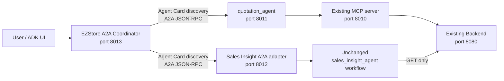

# EZStore A2A Coordinator

This application coordinates **read-only EZStore requests between independent agents using the Agent2Agent (A2A) protocol**. The current verified paths are quotation lookup through the existing `quotation_agent` and Customer Overview through an A2A wrapper around the unchanged `sales_insight_agent`. The Coordinator (`ezstore_a2a_coordinator`) routes requests deterministically, refuses business writes and off-topic requests, and returns the remote result. It does not use an LLM for routing or composition.

## Architecture



| Component | Responsibility | Local port | Coordinator communication |
|---|---|---:|---|
| `ezstore_a2a_coordinator` | Deterministic routing, refusal, A2A discovery/delegation, final response | 8013 | Receives user requests |
| `quotation_agent` | Existing quotation-management workflow; this Coordinator delegates quotation lookup only | 8011 | A2A JSON-RPC |
| Sales Insight A2A adapter | Exposes only Customer Overview from the unchanged `sales_insight_agent` workflow | 8012 | A2A JSON-RPC |
| Verification dashboard | Displays a saved A2A report without running agent actions | 8014 | Read-only HTTP |

The Coordinator retrieves each specialist's Agent Card with the A2A SDK, checks the agent identity and JSON-RPC interface, and sends an A2A message through the SDK client. It reads the returned Message or completed Task text, including final status messages or artifacts. A remote failure identifies the unavailable agent; the Coordinator has no direct Backend, MCP, database, or imported-specialist fallback. The specialists use their existing integrations for business data.

### Current capability boundary

| Request | Current behavior |
|---|---|
| `Show me quotation QT-20260330-001.` | Delegates a quotation lookup to `quotation_agent` over A2A. |
| `Give me an overview of customer 史塔克工業.` | Delegates Customer Overview to the Sales Insight A2A adapter. The wrapper runs the existing Sales Insight workflow and publishes its result as an A2A text artifact and completed Task status. |
| Other Sales Insight functions | The wrapper advertises only `customer_overview` and refuses unsupported requests. |
| Business write or off-topic request | Refused without performing the requested business change. |

The Coordinator source also contains an earlier experimental combined route. This README makes no acceptance claim for combined requests or additional Sales Insight functions.

## Endpoints and configuration

| Surface | Local URL |
|---|---|
| Coordinator ADK web UI | http://127.0.0.1:8013/dev-ui/ |
| Coordinator Agent Card | http://127.0.0.1:8013/a2a/ezstore_a2a_coordinator/.well-known/agent-card.json |
| Quotation Agent Card | http://127.0.0.1:8011/a2a/quotation_agent/.well-known/agent-card.json |
| Quotation A2A JSON-RPC | http://127.0.0.1:8011/a2a/quotation_agent |
| Sales Insight Agent Card | http://127.0.0.1:8012/.well-known/agent-card.json |
| Sales Insight A2A JSON-RPC | http://127.0.0.1:8012/a2a/sales_insight_agent |
| Saved-evidence dashboard | http://127.0.0.1:8014/ |

| Environment variable | Used by | Purpose |
|---|---|---|
| `QUOTATION_AGENT_CARD_URL` | Coordinator | Full quotation Agent Card URL |
| `SALES_INSIGHT_AGENT_CARD_URL` | Coordinator | Full Sales Insight Agent Card URL |
| `A2A_TIMEOUT_SECONDS` | Coordinator | A2A timeout; default 180 seconds |
| `APP_URL` | Quotation service, Coordinator | Advertised service origin |
| `MCP_URL` | Quotation service | Existing local MCP endpoint, normally `http://127.0.0.1:8010/mcp` |
| `BACKEND_URL` | Sales Insight wrapper/workflow | Existing read-only Backend API, normally `http://127.0.0.1:8080/api/v1` |
| `GEMINI_API_KEY`, `AGENT_MODEL` | Remote specialist workflows | Private AI Studio credential and model setting |

The Coordinator itself does not call Gemini. Keep credentials in private dotenv/process configuration; never commit a key. The quotation service loads `agent/.env` then the repository-root `.env` for values absent from its process environment. The Sales Insight wrapper loads the root `.env` then `agent2/.env` for absent values. Process values take precedence.

## Run locally

Use Python 3.12, `uv`, the existing specialist environments, and the existing EZStore data. From the repository root, start the existing data services without reseeding:

```powershell
docker compose up -d db backend mcp-server
```

In `a2a_app/`, install its locked environment once with `uv sync --frozen`. Run each of the following services in a separate terminal. Reuse an already running listener rather than starting a duplicate.

**Quotation specialist, from the repository root:**

```powershell
Set-Location agent
Remove-Item Env:GEMINI_API_KEY, Env:GOOGLE_API_KEY -ErrorAction SilentlyContinue
$env:GOOGLE_GENAI_USE_VERTEXAI = 'false'
$env:GOOGLE_GENAI_USE_ENTERPRISE = 'FALSE'
$env:MCP_URL = 'http://127.0.0.1:8010/mcp'
$env:APP_URL = 'http://127.0.0.1:8011'
$env:PYTHONDONTWRITEBYTECODE = '1'
uv run --no-sync uvicorn quotation_agent.fast_api_app:app --host 127.0.0.1 --port 8011
```

**Sales Insight A2A wrapper, from the repository root:**

```powershell
Set-Location a2a_app
Remove-Item Env:GEMINI_API_KEY, Env:GOOGLE_API_KEY -ErrorAction SilentlyContinue
$env:GOOGLE_GENAI_USE_VERTEXAI = 'false'
$env:BACKEND_URL = 'http://127.0.0.1:8080/api/v1'
$env:PYTHONDONTWRITEBYTECODE = '1'
uv run --no-sync python -m ezstore_a2a_coordinator.sales_insight_a2a_adapter
```

**Coordinator, from the repository root:**

```powershell
Set-Location a2a_app
$env:QUOTATION_AGENT_CARD_URL = 'http://127.0.0.1:8011/a2a/quotation_agent/.well-known/agent-card.json'
$env:SALES_INSIGHT_AGENT_CARD_URL = 'http://127.0.0.1:8012/.well-known/agent-card.json'
$env:APP_URL = 'http://127.0.0.1:8013'
uv run --no-sync uvicorn ezstore_a2a_coordinator.fast_api_app:app --host 127.0.0.1 --port 8013
```

Open the Coordinator ADK web UI, select `ezstore_a2a_coordinator`, and send either example in the capability table. The quotation reply comes from the quotation specialist; the overview reply comes from the Sales Insight specialist. Values reflect current Backend data. The frontend on port 3000 is useful for opening quotation system links.

## Tests and saved verification

From `a2a_app/`:

```powershell
uv run --no-sync pytest -p no:cacheprovider tests/unit tests/integration
$env:PYTHONPATH = (Get-Location).Path
$runDir = 'artifacts/customer-overview-' + (Get-Date).ToUniversalTime().ToString('yyyyMMddTHHmmssZ')
uv run --no-sync python tests/acceptance/customer_overview_a2a.py --output $runDir
uv run --no-sync python -m ezstore_a2a_coordinator.customer_overview_dashboard --report "$runDir/verification.json" --port 8014
```

The live verifier requires all three services. It saves Agent Cards, A2A Tasks and request history, matching remote/Coordinator replies, refusals, a quotation regression, and source integrity checks in a new directory. It refuses to overwrite an existing report. The dashboard reads the saved report; its PASS/FAIL labels and Customer Overview text come from that report, not fixed page content.

**Latest recorded result:** [Customer Overview verification](artifacts/customer-overview-20261027T185015Z/summary.md) passed all 10 recorded checks. The Sales Insight Agent Card advertised one `customer_overview` skill; one completed Sales Insight Task returned a matching Customer Overview reply. Unsupported, write, and off-topic checks passed. A separate quotation A2A Task completed and matched the Coordinator reply. The [JUnit report](artifacts/customer-overview-20261027T185015Z/unit-integration.xml) records **40/40 unit and integration tests passed**. See the [raw A2A report](artifacts/customer-overview-20261027T185015Z/verification.json), [dashboard screenshot](artifacts/customer-overview-20261027T185015Z/dashboard-evidence.png), and [browser/report comparison](artifacts/customer-overview-20261027T185015Z/dashboard-browser-check.json).

**Historical quotation-only verification:** the earlier accepted [Stage 3 evidence](artifacts/stage3/quotation-only-20261027T123552Z.json) and [Stage 4 report](artifacts/stage4/quotation-20261027T125412Z/verification.json) cover only `Coordinator → A2A → quotation_agent`. Those records remain unchanged and are distinct from the later Customer Overview extension.

## Integrity

The latest verification recorded that protected tracked files and prior A2A evidence were unchanged. The existing `agent/`, `agent2/`, `frontend/`, `backend/`, `mcp_server/`, seed data, and Docker Compose files were not modified for this extension. Implementation and documentation changes are inside `a2a_app/`; the Coordinator contains no direct business-data fallback. No commit is performed automatically.