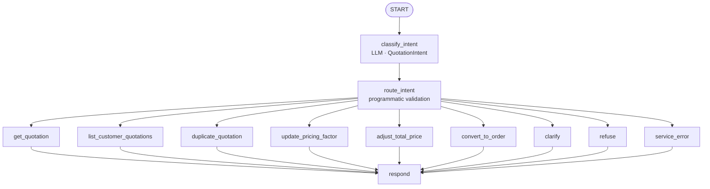

# EZStore quotation Agent

This service implements the quotation-management chat agent for EZStore. It runs on Python 3.12 with Google ADK's `google.adk.workflow.Workflow`, connects to the existing MCP Server with `McpToolset` over Streamable HTTP, and serves the Chat UI through ADK's FastAPI app. The ADK app name is `quotation_agent`.

## Workflow design

Only `classify_intent` calls Gemini. It returns the Pydantic `QuotationIntent`; `route_intent` validates the allowed domain and required fields, then dispatches by code. An operation node calls exactly one MCP tool. `clarify`, `refuse`, and `service_error` also end at the shared `respond` node, which emits the final text consumed by the UI.



The operation wrappers pass one tool name to `_execute_tool`; its `tool_filter` allows only that MCP tool for the request. Tool response text is preserved for the user, including the server's copy-on-write notice and plain-text links. Pricing-factor and total-price changes create a copy before changing it. Missing fields are stored under `pending_quotation_request`; the next message can complete that operation. Restored sessions can recover the pending request from their event history. Off-topic requests are rejected by program logic.

### Main files

| File | Responsibility |
|---|---|
| `quotation_agent/agent.py` | Gemini classifier, Workflow nodes, MCP tool wrappers, ADK `App` |
| `quotation_agent/schemas.py` | Pydantic intent and tool parameters |
| `quotation_agent/policy.py` | Required fields, validation, domain guardrails, and tool argument allowlists |
| `quotation_agent/config.py` | Model, MCP URL, and credentials from environment/`.env` |
| `quotation_agent/fast_api_app.py` | ADK FastAPI routes and A2A/SSE setup |
| `tests/unit/` | Workflow, policy, eval adapter, and SSE tests |
| `tests/eval/datasets/` | Six action cases and guardrail/multi-turn cases |
| `tests/eval/eval_config.yaml` | The four evaluation metrics and judge rubrics |

## Configuration

Keep credentials in the repository-root `.env`, copied from `../.env.example`; do not commit API keys. The project wrapper loads that root file for local CLI and evaluation commands. `agent/.env` is optional and is useful for local-only overrides such as `MCP_URL`.

| Variable | Local Agent | Compose Agent |
|---|---|---|
| `AGENT_MODEL` | `gemini-3.8-flash` (default) | `gemini-3.8-flash` (default) |
| `MCP_URL` | `http://localhost:8010/mcp` | `http://mcp-server:8000/mcp` |
| `MCP_HOST_PORT` | MCP host mapping defaults to `8010` | MCP internal URL remains `http://mcp-server:8000/mcp` |
| `FRONTEND_URL` | MCP system links default to `http://localhost:3000` | MCP system links default to `http://localhost:3000` |
| `ALLOW_ORIGINS` | Backend CORS defaults to `http://localhost:3000` | Backend CORS defaults to `http://localhost:3000` |
| `GEMINI_API_KEY` | AI Studio key in root `.env` | Passed from root `.env` |
| `GOOGLE_GENAI_USE_VERTEXAI` | Set `true` to use Vertex AI | Set `true` only when ADC is available inside the container |
| `GOOGLE_CLOUD_PROJECT` | Vertex AI project ID | Vertex AI project ID |
| `GOOGLE_CLOUD_LOCATION` | `global` for Vertex AI | `global` for Vertex AI |

With no credential, the Agent process still starts and returns a clear error for model-dependent conversations. For local Vertex AI, first run `gcloud auth application-default login`. AI Studio is the recommended Compose configuration.

## Local development

From the repository root, create `.env` and add `GEMINI_API_KEY`. For PowerShell:

```powershell
Copy-Item .env.example .env
Copy-Item agent/.env.example agent/.env
```

Set `MCP_URL=http://localhost:8010/mcp` in `agent/.env`, then start the provided services and seed the database:

```powershell
docker compose up -d db backend mcp-server
docker compose exec db psql -U ezstore -f /scripts/seed-test-data.sql
```

In another terminal:

```powershell
cd agent
uv sync --group dev --extra eval
agents-cli playground
agents-cli run "我要查詢報價單，報價單編號：QT-20260330-001"
```

For the full Chat UI and container setup, return to the repository root and run:

```powershell
docker compose -f docker-compose.yml -f docker-compose.build.yml up -d --build
docker compose ps
```

The UI is at `http://localhost:3000/agent`. The Agent container exposes port 8080 only on the Compose network; nginx routes `/agent-api/` to it.

## Tests and evaluation

Run from `agent/`:

```powershell
uv run --no-sync pytest tests/unit -q
uv run --no-sync pytest tests/integration -q
```

Unit tests do not call Gemini or MCP. Integration tests start a local ADK/A2A server and exercise its HTTP/SSE transports.

The evaluation CLI uses Gemini and writes native JSON/HTML reports under the requested output directory:

```powershell
agents-cli eval run --dataset tests/eval/datasets/quotation-actions.json --config tests/eval/eval_config.yaml --concurrency 1 --qps 0.05 --output artifacts/grade_results/actions
agents-cli eval run --dataset tests/eval/datasets/quotation-guardrails.json --config tests/eval/eval_config.yaml --concurrency 1 --qps 0.05 --output artifacts/grade_results/guardrails
```

The actions dataset creates quotation copies and an order; reload `scripts/seed-test-data.sql` before repeating it. The guardrails dataset includes two off-topic cases and one multi-turn clarification. The config always runs `custom_response_quality`, `link_present`, `refusal_or_action`, and `agent_turn_count`.

From the repository root, the independent self-grader runs both datasets and two additional cases, verifies the backend postconditions, and writes a per-case report:

```powershell
uv run --no-sync --project agent --env-file .env python scripts/grading/grade_agent.py --suite scripts/grading/student-suite.json
```

## Adding an operation

First ensure the MCP Server already exposes the tool and its input/output schema. Agent operation nodes must call an MCP tool; they should not bypass MCP to access the backend directly.

1. Add the operation name and any new parameter fields to the `QuotationIntent` schema in `quotation_agent/schemas.py`. Update `CLASSIFIER_INSTRUCTION` in `agent.py` so the classifier can name the intent and extract those fields.
2. In `quotation_agent/policy.py`, add the operation's required fields to `REQUIRED_FIELDS`, user-facing labels to `FIELD_LABELS`, and any needed deterministic validation. Keep `missing_fields()` and `tool_arguments()` aligned with the schema.
3. Add a thin wrapper in `quotation_agent/agent.py` that delegates to the one allowed MCP tool:

   ```python
   async def new_operation(ctx: Context, node_input: QuotationIntent) -> AsyncIterator[Event]:
       async for event in _execute_tool(ctx, node_input, "new_operation"):
           yield event
   ```

4. Add the wrapper to `OPERATIONS`. The Workflow builds operation routes from this tuple, and each wrapper must use the exact MCP tool name.
5. Add unit coverage for classification fields, required-field/argument validation, and deterministic routing. Add a dataset case whose `eval_case_id` is the MCP tool name, with a reference and any independent post-checks needed.
6. Run unit tests and the relevant eval dataset. Reseed the database before repeating a case that creates or modifies records.

Do not add an LLM call to an operation node or `respond`. Keep domain refusal and argument checks in code, preserve tool response text, and return plain-text system links.
