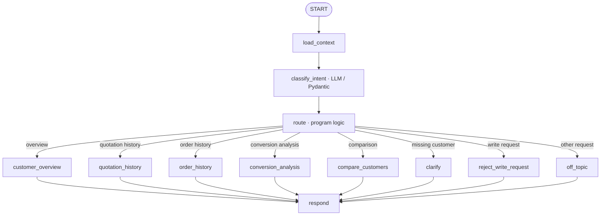

# Sales & Customer Insight Agent

`sales_insight_agent` is an independent, read-only Google ADK application for exploring EZStore customer sales data. It reads customer, quotation, and order records from the existing Backend REST API. It does not create or change records, and it is not connected to the First Agent's quotation-management tools or the frontend.

## Supported functions

The Agent supports these five customer insight operations:

1. **Customer overview** — customer name, level, credit score, quotation and order counts and totals, and a summary of order statuses.
2. **Quotation history** — each quotation's number, status, total price, and creation date.
3. **Order history** — each order's number, status, total price, creation date, and linked quotation when present. An order with no `quotation_id` is identified as a standalone order.
4. **Quotation conversion analysis** — matches each order's `quotation_id` to quotation IDs, then reports converted and unconverted quotations and the conversion ratio.
5. **Customer comparison** — compares customer level, credit score, quotation and order counts and totals, and linked quotation conversion counts for two customers.

Business values and calculations come from Backend API responses. If a customer name is missing, the Agent asks for it and continues the pending operation when the user supplies it. It asks the user to choose when customer search is ambiguous and clearly reports when there is no match. Requests to change data or to do anything outside these five read-only functions are refused.

## Workflow

The ADK Graph Workflow uses the LLM only to classify the user's intent and extract customer names. Routing, input validation, API calls, calculations, write refusal, and final response selection are handled by application code.



All data access goes through `ReadOnlyBackendClient` in `sales_insight_agent/backend_client.py`. It constructs only HTTP `GET` requests and limits paths to customer, quotation, and order read endpoints. List calls follow Backend pagination using the returned total/page size so calculations include all pages.

## Environment variables

Configure these values in `agent2/.env` or in the shell that starts the Agent:

| Variable | Purpose | Example |
| --- | --- | --- |
| `BACKEND_URL` | Backend API base URL | `http://localhost:8080/api/v1` |
| `AGENT_MODEL` | Gemini model used for intent classification | `gemini-3.8-flash` |
| `GEMINI_API_KEY` | Google AI Studio credential; keep it private and out of Git | Set to your own key |

Start from the `agent2/` directory so `python-dotenv` loads its `.env`. A safe setup is to copy `.env.example` to `.env` and replace the placeholder key locally. Do not commit `.env` or put a real key in source files.

## Local run

Requirements: Python 3.12, `uv`, `agents-cli`, and a running EZStore Backend. From the repository root:

```powershell
Set-Location agent2
Copy-Item .env.example .env
# Edit .env and set GEMINI_API_KEY; confirm BACKEND_URL reaches the running Backend.
uv sync
agents-cli playground --port 8003
```

The Playground serves the `sales_insight_agent` ADK app locally at `http://localhost:8003`. Choose another free port if needed. Enter natural-language requests such as:

```text
請幫我查看史塔克工業的客戶銷售概況
請列出史塔克工業的報價歷史
請列出史塔克工業的訂單歷史
分析史塔克工業有哪些報價已經轉成訂單
比較史塔克工業和膠囊公司的銷售活動
```

The Backend URL is configurable; when the Backend runs in Docker, use a host-reachable address from the local Playground process. The default above is for a local Backend published on port 8080.

## Tests and evaluation

Run the unit suite from `agent2/`:

```powershell
uv run --no-sync pytest tests/unit
```

The unit tests cover the five insight operations, off-topic refusal, write-request refusal with no write HTTP methods, and clarification followed by continuation. Integration tests are under `tests/integration/` and require the configured Backend/ADK environment.

The evaluation dataset and metrics are in `tests/eval/`. With the Playground running, generate and grade the dataset using the local app URL:

```powershell
agents-cli eval run --dataset tests/eval/datasets/basic-dataset.json --config tests/eval/eval_config.yaml --url http://localhost:8003 --app-name sales_insight_agent
```

The configured metrics are `custom_response_quality` and `agent_turn_count`. The response-quality judge uses `AGENT_MODEL` when set and otherwise defaults to `gemini-3.8-flash`; it requires a usable Gemini credential. For data-safety verification, compare the relevant Backend records before and after evaluation using GET requests only.
